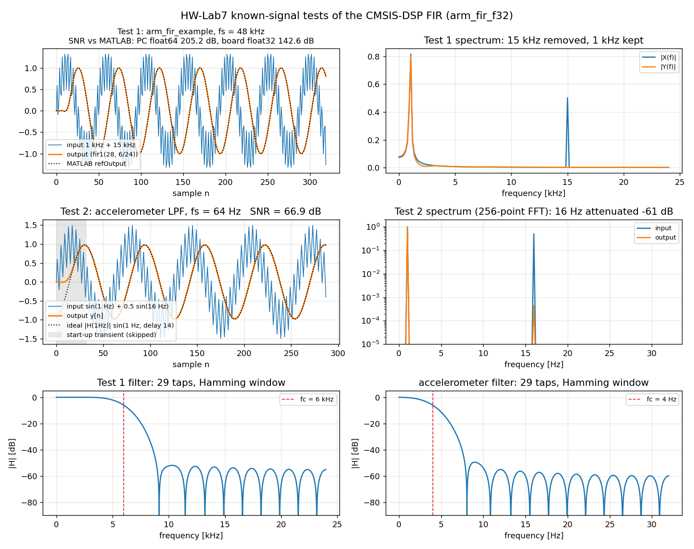
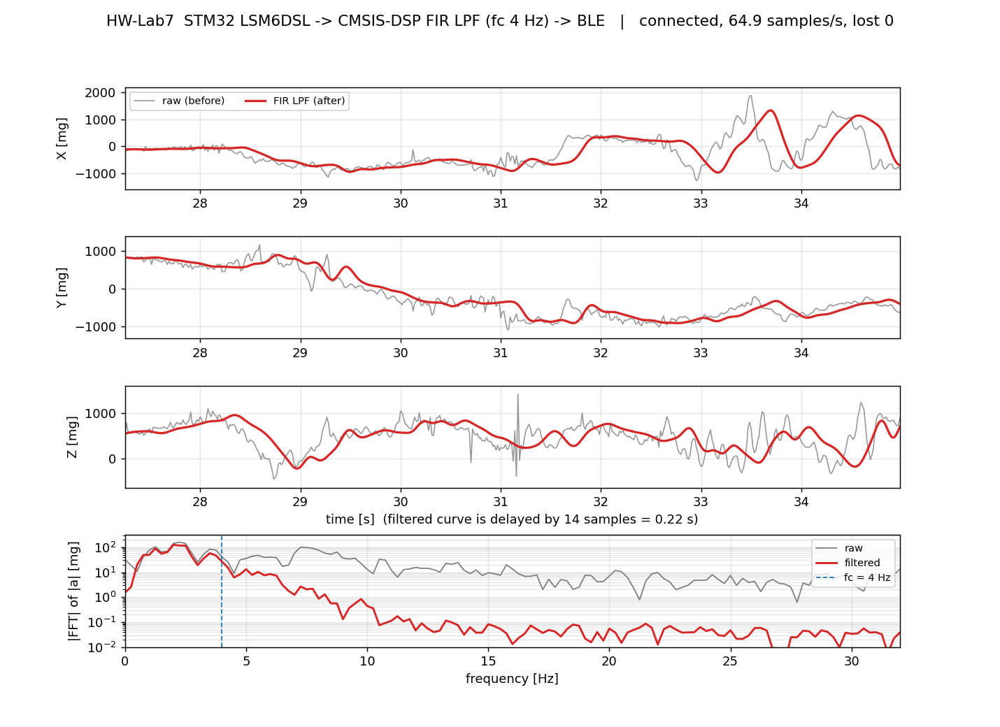

# HW-Lab7：CMSIS-DSP Programming

板子：**B-L475E-IOT01A**（STM32L475）　工具：STM32CubeIDE 2.2 / FW_L4 V1.18.2 內附的 CMSIS-DSP（`libarm_cortexM4lf_math.a`）
**全部已在實體板子上驗證過**（UART 輸出 + 電腦藍牙接收）。

| 項目 | 內容 | 驗證結果 |
|---|---|---|
| **Basic** | 用 CMSIS-DSP `arm_fir_f32()` 對 **LSM6DSL 三軸加速度**做 FIR 低通（29 taps、fc = 4 Hz、fs = 64 Hz）。處理實際資料前，先用**兩組已知訊號**驗證 | Test 1（官方 `arm_fir_example`）SNR = **142.59 dB** ≥ 140 → SUCCESS；Test 2（自己的濾波器）SNR = **66.92 dB**、16 Hz 衰減 **−61.1 dB** → SUCCESS |
| **加分題** (+10) | CMSIS-RTOS2 三個 task：**TASK_SENSOR**（最高優先權，TIM2 計時器觸發讀感測器）→ **TASK_DSP**（濾波）→ **TASK_BLE**（用 **BLE** 把濾波前、濾波後的資料傳到電腦），電腦端即時畫圖 | 64 筆/秒，**lost 0**；實測 8–32 Hz 衰減 48–53 dB，0–3 Hz 幾乎不變 |

Basic 跟加分題做在**同一個專案** `lab07_dsp/`：開機先跑已知訊號測試，接著進入即時處理。

## 檔案

| 檔案 | 用途 |
|---|---|
| `lab07_dsp/` | CubeIDE 專案（從 lab04 的 BLE + LSM6DSL + FreeRTOS 專案改過來） |
| `lab07_dsp/Core/Src/dsp_filter.c` | **DSP 程式**：已知訊號測試（Test 1、Test 2）、即時 FIR 濾波 |
| `lab07_dsp/Core/Src/main.c` | 三個 RTOS task、TIM2 設定 |
| `lab07_dsp/Core/Src/stm32l4xx_it.c` | `TIM2_IRQHandler`：叫醒 TASK_SENSOR |
| `lab07_dsp/Core/Src/dsp_service.c` | BLE GATT service（濾波前 + 濾波後的資料） |
| `lab07_dsp/Core/Src/arm_fir_data.c`、`math_helper.c/.h` | 從 `Drivers/CMSIS/DSP/Examples/ARM/arm_fir_example` 複製過來（講義 p.19） |
| `lab07_client.py` | 電腦端：BLE 接收 + 即時畫圖（濾波前 / 後、頻譜） |
| `plot_known_signal.py` | 畫已知訊號測試的圖 → `known_signal_test.png` |
| `demo.ps1` | 一鍵燒錄 + 重置 + 顯示 UART 輸出 |
| `uart_log.txt` | 板子實際的 UART 輸出（完整的測試結果） |
| `ble_live_plot.png`、`ble_data.csv` | 電腦用 BLE 收到的實測資料（晃動板子時錄的） |
| `report_optional.md` | 加分題個人報告 |

---

## Demo 方法（VS Code 終端機）

USB 接板子的 **ST-LINK 口（CN7）**。

```powershell
cd E:\C++\lab07
powershell -ExecutionPolicy Bypass -File .\demo.ps1            # 燒錄 + 重置 + 看 UART（Ctrl+C 停止）
powershell -ExecutionPolicy Bypass -File .\demo.ps1 -NoFlash   # 不重燒，只重置 + 看輸出
```

加分題（另開一個終端機，板子要先在跑）：

```powershell
cd E:\C++\lab07
py lab07_client.py                          # 即時畫圖，拿起板子晃一晃
py lab07_client.py --save ble_live_plot.png # 關掉視窗時存圖
py lab07_client.py --no-plot --duration 10  # 只用文字確認 BLE 連線
```

* 要用 `py`（`C:\Users\popo5\AppData\Local\Programs\Python\Python311`，有裝 bleak / numpy / matplotlib），**不要**用 msys 的 `python`。
* client 用名稱 `LAB7DSP` 找板子，斷線會自動重連。手機的 ST BLE App 要關掉（板子一次只接受一個連線）。
* 在 CubeIDE 裡開：**File → Import → Existing Projects into Workspace** → 選 `E:\C++\lab07\lab07_dsp` → **Build Project**。

---

## Basic：怎麼把 CMSIS-DSP 加進 CubeIDE（講義 p.18–20）

1. 複製 FW_L4 套件內的 CMSIS-DSP：
   * `Drivers/CMSIS/DSP/Include/*.h` → `lab07_dsp/Drivers/CMSIS/DSP/Include/`
   * `Drivers/CMSIS/DSP/Lib/GCC/libarm_cortexM4lf_math.a` → `lab07_dsp/Drivers/CMSIS/Lib/GCC/`（**lf** = little-endian + 硬體 FPU，對應專案的 `-mfloat-abi=hard`）
2. 專案設定（Properties → C/C++ Build → Settings）：
   * MCU GCC Compiler → Include paths：加 `../Drivers/CMSIS/DSP/Include`
   * MCU GCC Linker → Libraries：`-l arm_cortexM4lf_math`，Library search path：`Drivers/CMSIS/Lib/GCC`
   * 這版 `arm_math.h`（V1.6.0）會用 `__ARM_FEATURE_DSP` 自動判斷，**不用**再定義 `ARM_MATH_CM4`。
3. 照講義 p.19：`math_helper.h` → `Core/Inc`，`math_helper.c`、`arm_fir_data.c` → `Core/Src`，`arm_fir_example_f32.c` 的內容改寫進 `dsp_filter.c`。
4. printf 走 USART1（ST-LINK 虛擬 COM 埠，115200 8N1）：`__io_putchar()` 已經在 BSP 的 `custom.c` 裡（講義 p.20 的寫法）。沒有開 `_printf_float`，小數用 `DSP_FloatStr()` 自己轉。

## Basic：先用已知訊號驗證（`dsp_filter.c`）



### Test 1：官方 `arm_fir_example`（講義 p.15–17、p.21）

輸入 1 kHz + 15 kHz（fs = 48 kHz，320 點），`fir1(28, 6/24)` 29 taps 低通（fc = 6 kHz），每次處理 32 點。輸出用 `arm_snr_f32()` 跟 MATLAB 算好的 `refOutput` 比。

```
SNR(arm_fir_f32 vs MATLAB refOutput) = +142.59 dB  (threshold 140 dB)
max |arm_fir_f32 - plain C FIR|     = +0.000000
cycles for 320 samples: arm_fir_f32 = 40592, plain C = 410303  (+10.11 x faster)
Test 1 result: SUCCESS
```

* 另外寫了一個一般 C 迴圈版的 FIR 對照：結果完全一樣，但 **CMSIS-DSP 快 10 倍**（DWT cycle counter 量的）。
* 在電腦上用 double 算的 SNR 是 205 dB，板子是 float32 所以 142.6 dB，超過門檻 140 dB。

### Test 2：加速度計要用的濾波器

| 參數 | 值 |
|---|---|
| 取樣頻率 | fs = 64 Hz（TIM2） |
| 濾波器 | `fir1(28, 4/32)`：29 taps、Hamming window、fc = 4 Hz（人體動作大多 < 4 Hz） |
| 延遲 | 線性相位，(29 − 1) / 2 = **14 點 = 0.22 s** |
| 係數順序 | `arm_fir_f32` 要求係數反序（`fliplr(h)`），這個濾波器左右對稱所以一樣 |

已知訊號：x[n] = sin(2π·1·n/64) + 0.5·sin(2π·16·n/64)，共 288 點，**跟即時處理一樣每次 16 點**。

```
theory: |H(1 Hz)| = +0.9771 (-0.20 dB), |H(16 Hz)| = +0.000881 (-61.10 dB)
SNR(y vs ideal 1 Hz output, n = 32..287) = +66.92 dB
FFT (arm_cfft_f32, N = 256, 0.25 Hz/bin)   input      output    gain
   bin  4 ( 1 Hz) amplitude              +1.0000   +0.9771  -0.20 dB
   bin 64 (16 Hz) amplitude              +0.5000  +0.000440  -61.10 dB
   largest bins: input -> bin 4 (+1.00 Hz), output -> bin 4 (+1.00 Hz)
Test 2 result: SUCCESS  (need SNR > 40 dB, 16 Hz < -40 dB, 1 Hz within 0.5 dB)
```

* **時域**：輸出跟「理想輸出 = |H(1 Hz)|·sin(1 Hz，延遲 14 點)」比，SNR 66.9 dB（跳過前 32 點的暫態）。
* **頻域**：用 `arm_cfft_f32` 做 256 點 FFT，1 Hz 只掉 0.2 dB，16 Hz 衰減 61 dB，跟理論值完全一樣。
* 板子上的數字跟 `plot_known_signal.py`（scipy）算的一致。

### 實際資料

驗證完才啟動 TIM2，開始處理 LSM6DSL 的資料（I2C2，±2 g，單位 mg）。每 16 點印一行：

```
[    1] seq    31 raw X=   21 Y=  323 Z=  973 | filt X=   21 Y=  323 Z=  972 mg | FIR 6384 cyc | BLE off sent=0 drop=0
```

* 第一個區塊濾波後的值偏小（例如 Z = 664）是 FIR 暫態：狀態一開始是 0，要 29 點才填滿。
* 三軸 × 16 點只要 **6384 cycles = 1.6 ms**（SYSCLK 4 MHz），每 250 ms 做一次 → CPU 負載約 0.6 %。

---

## 加分題：三個 CMSIS-RTOS2 task + BLE

```
TIM2 update IRQ (64 Hz) ──osThreadFlagsSet──▶ TASK_SENSOR  (osPriorityHigh)
                                               讀 LSM6DSL (I2C2)
                                                  │ rawQueue: {seq, xyz}
                                                  ▼
                                              TASK_DSP     (osPriorityAboveNormal)
                                               收滿 16 點 → arm_fir_f32 × 3 軸
                                                  │ txQueue: {seq, raw xyz, filt xyz}
                                                  ▼
                                              TASK_BLE     (osPriorityNormal)
                                               HCI 事件 + GATT notify ──BLE──▶ PC (lab07_client.py)
```

| 項目 | 說明 |
|---|---|
| 計時器 | TIM2 時脈 = PCLK1 = 4 MHz，PSC = 3（→ 1 MHz），ARR = 15624 → **4 MHz / (4 × 15625) = 64 Hz** |
| ISR | `TIM2_IRQHandler` 只做 `osThreadFlagsSet(TASK_SENSOR)`。NVIC 優先權 5 = `configLIBRARY_MAX_SYSCALL_INTERRUPT_PRIORITY`，所以可以呼叫 RTOS API |
| 為什麼用旗標 + queue | 讀 I2C 要約 1 ms，不放在 ISR；task 之間用 message queue 傳資料，DSP 處理或 BLE 傳輸慢一點也不會掉資料 |
| BLE 格式 | service `a0070000-8e22-4541-9d4c-21edae82ed19`，characteristic `a0070001-…`（notify），14 bytes：`uint16 seq, int16 raw[3], int16 filt[3]` |
| 掉資料偵測 | 每筆都有 seq，電腦端檢查有沒有跳號（實測 lost 0） |

電腦端 `lab07_client.py`（bleak + matplotlib）：上面三張圖是 X / Y / Z 濾波前（灰）跟濾波後（紅），最下面是 |a| 的頻譜。



拿起板子晃動時錄的資料（`ble_data.csv`），濾波前後各頻帶的能量變化：

| 軸 | 0–3 Hz（通帶） | 8–32 Hz（阻帶） |
|---|---|---|
| X | −0.3 dB | **−49.2 dB** |
| Y | +0.3 dB | **−47.9 dB** |
| Z | −0.3 dB | **−52.9 dB** |

---

## 跟 lab04 比改了什麼

* 拿掉 lab04 的取樣頻率 characteristic 和 significant motion（PD11 中斷），換成 `dsp_service`；BLE 名稱改成 `LAB7DSP`。
* BLE 廣播間隔從 1000–1200 ms 改成 100–200 ms（`sensor.c`），附近藍牙裝置很多時，電腦比較快找到板子。
* 兩個 task → 三個 task（`.ioc` 的 FREERTOS.Tasks01 也同步改了）。TIM2 用暫存器直接設定，寫在 USER CODE 區塊，CubeMX 重新 Generate 不會被蓋掉。
* **I2C bus recovery**（`ACC_BusRecover()`）：板子如果在 I2C 讀到一半時被重置，LSM6DSL 會一直拉住 SDA，之後每次讀都失敗（測試時遇過 `LSM6DSL init failed!`）。現在初始化失敗時會手動打 SCL 脈波讓它放開 SDA，再重新初始化（連續重置 6 次測試，第 5 次有遇到並自動救回）。
