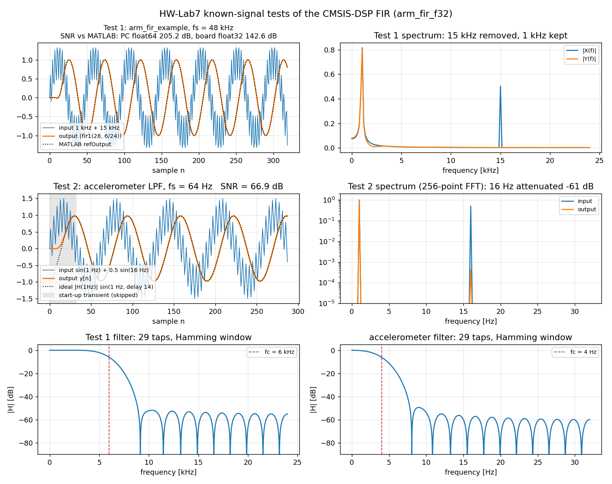
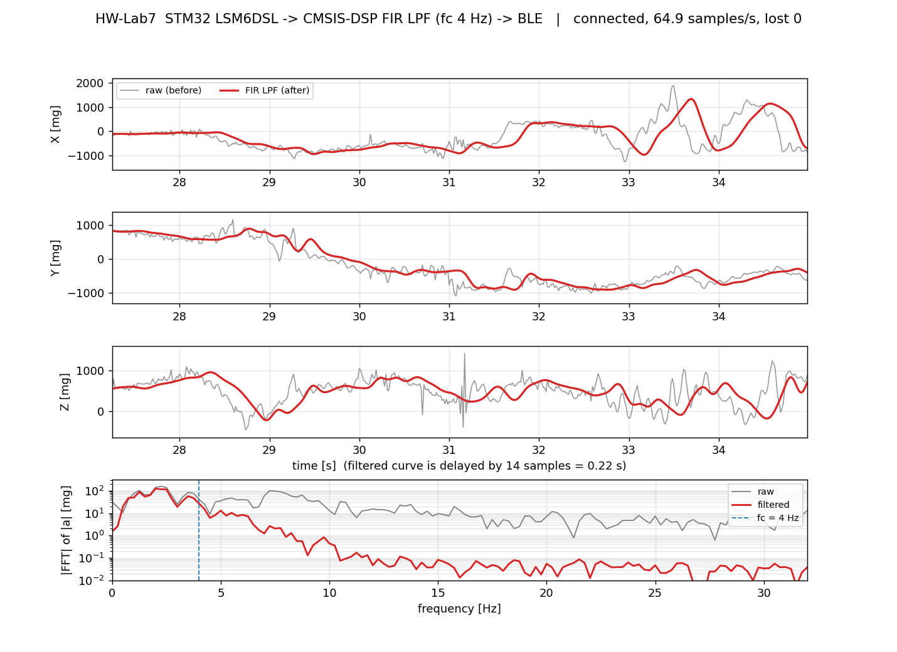

# HW-Lab7 加分題報告：CMSIS-RTOS2 三工作排程 + CMSIS-DSP 濾波 + BLE 傳輸

姓名：＿＿＿＿＿＿　學號：＿＿＿＿＿＿

## 1. 目標

在 STM32 IoT Node（B-L475E-IOT01A）上用 CMSIS-RTOS2 排程三個 task：

1. **最高優先權**的 task 由**計時器觸發**，週期性讀取感測器（LSM6DSL 三軸加速度計）。
2. 第二個 task 用**數位濾波器**（CMSIS-DSP FIR 低通）處理資料。
3. 第三個 task 把**濾波前**與**濾波後**的資料用 **BLE** 傳到 PC，在 PC 上即時畫圖比對。

## 2. 系統架構

```
TIM2 update IRQ (64 Hz) ──thread flag──▶ TASK_SENSOR  (osPriorityHigh)
                                           I2C2 讀 LSM6DSL 三軸加速度 (mg)
                                              │ rawQueue (32 筆)
                                              ▼
                                          TASK_DSP     (osPriorityAboveNormal)
                                           每 16 點：arm_fir_f32() × 3 軸
                                              │ txQueue (64 筆)：濾波前 + 濾波後
                                              ▼
                                          TASK_BLE     (osPriorityNormal)
                                           BlueNRG-MS 事件處理 + GATT notify ──BLE──▶ PC
```

| Task | 優先權 | Stack | 工作 |
|---|---|---|---|
| TASK_SENSOR | High (40) | 1 KB | 等 TIM2 的 thread flag → 讀 LSM6DSL → 放進 rawQueue |
| TASK_DSP | AboveNormal (32) | 3 KB | 開機先跑已知訊號測試；之後每收滿 16 點做一次 FIR，結果放進 txQueue |
| TASK_BLE | Normal (24) | 2 KB | 處理 BLE 連線事件；每筆資料送一個 notification |

設計重點：

* **計時器觸發**：TIM2 時脈 4 MHz，PSC = 3、ARR = 15624 → 4 MHz / (4 × 15625) = **64.000 Hz**。ISR 只呼叫 `osThreadFlagsSet()`，真正讀 I2C（約 1 ms）的工作交給 task，ISR 保持很短。TIM2 的 NVIC 優先權設 5（= `configLIBRARY_MAX_SYSCALL_INTERRUPT_PRIORITY`），才能在 ISR 中呼叫 RTOS API。
* **優先權順序 = 時間要求的嚴格程度**：取樣時間點最重要（不能晚），所以 TASK_SENSOR 最高；DSP 次之；BLE 傳輸慢一點沒關係，因為中間有 queue 緩衝。
* **Queue 解耦**：DSP 一次處理 16 點（區塊處理比逐點呼叫有效率），BLE 一次送 1 點，三個 task 的節奏不同，用 message queue 串接。每筆資料帶 16-bit 序號，PC 端可以檢查有沒有掉資料。

## 3. 數位濾波器

| 參數 | 值 |
|---|---|
| 類型 | FIR 低通，29 taps，Hamming window（= MATLAB `fir1(28, 4/32)`） |
| fs / fc | 64 Hz / 4 Hz（人手的動作大多低於 4 Hz，較高頻是震動與雜訊） |
| 理論響應 | 1 Hz：−0.20 dB；16 Hz：−61.1 dB；阻帶約 −50 dB 以下 |
| 延遲 | 線性相位，固定延遲 14 點 = 0.22 s |
| 實作 | `arm_fir_init_f32()` + `arm_fir_f32()`，每軸一個 instance（各自保存狀態），blockSize = 16 |

**先用已知訊號驗證**（開機時在板子上執行，結果印在 UART）：

* Test 1：CMSIS 官方 `arm_fir_example`（1 kHz + 15 kHz）跟 MATLAB 參考輸出比，SNR = **142.59 dB**（門檻 140 dB）→ SUCCESS。同一份資料用一般 C 迴圈算的結果完全相同，但 CMSIS-DSP 只用 40592 cycles，C 迴圈要 410303 cycles，**快 10.1 倍**。
* Test 2：本題的濾波器，輸入 sin(1 Hz) + 0.5·sin(16 Hz)，輸出跟理想輸出（|H(1 Hz)|·sin，延遲 14 點）比 SNR = **66.92 dB**；用 `arm_cfft_f32` 做 256 點 FFT，1 Hz 增益 −0.20 dB、16 Hz 增益 **−61.10 dB**，跟理論值一致 → SUCCESS。



## 4. BLE 傳輸與 PC 端

* 板子是 GATT server，自訂 service `a0070000-8e22-4541-9d4c-21edae82ed19`，characteristic `a0070001-…`（Read / Notify），每筆 14 bytes：`uint16 seq, int16 raw_x, raw_y, raw_z, int16 filt_x, filt_y, filt_z`（單位 mg，little endian）。
* BlueNRG 的傳送緩衝滿了會回傳 `BLE_STATUS_INSUFFICIENT_RESOURCES`，TASK_BLE 先處理事件、等 2 ms 再重送。
* PC 端 `lab07_client.py`（Python，bleak + matplotlib）：掃描名稱 `LAB7DSP` → 連線 → 開 notification → 即時畫 X / Y / Z 濾波前後的波形，以及加速度大小 |a| 的頻譜；可存 CSV 和圖檔，斷線會自動重連。

## 5. 實測結果



* 傳輸率 64 筆/秒，序號沒有跳號（**lost 0**）。
* 拿起板子晃動時，灰色（濾波前）有很多尖刺與高頻抖動，紅色（濾波後）平滑；紅色比灰色晚約 0.22 s，就是 FIR 的群延遲。
* 用錄下的 `ble_data.csv` 計算濾波前後各頻帶能量：

| 軸 | 0–3 Hz（通帶） | 8–32 Hz（阻帶） |
|---|---|---|
| X | −0.3 dB | −49.2 dB |
| Y | +0.3 dB | −47.9 dB |
| Z | −0.3 dB | −52.9 dB |

  通帶幾乎不變，阻帶衰減約 50 dB，跟設計值相符。
* 運算量：三軸 × 16 點的 `arm_fir_f32` 共 6384 cycles，在 4 MHz 下是 1.6 ms，每 250 ms 做一次，CPU 負載約 0.6 %。

## 6. 遇到的問題與解決

1. **重置後感測器讀不到（`LSM6DSL init failed!`）**：如果 MCU 在 I2C 讀取途中被重置，LSM6DSL 還在等時脈，會一直把 SDA 拉低，之後所有 I2C 傳輸都失敗。解法：初始化失敗時，把 PB10 / PB11 暫時改成 GPIO，手動打最多 16 個 SCL 脈波直到 SDA 被放開，再送一個 STOP，重新初始化 I2C 後重試。連續重置 6 次測試，其中一次觸發此機制並成功恢復。
2. **多個 task 都在用 printf**：ISR 裡不印東西，只在 task 中印；即時資料每 16 點只印一行，避免 UART（115200 bps，阻塞式傳送）佔太多 CPU 時間。
3. **Windows 的 GATT 快取（預防措施）**：同一塊板子之前燒過 lab04（BLE 位址相同，但 service 不同），為了避免 Windows 沿用舊的 service 表，PC 端連線時設定 `use_cached_services=False` 重新探索；另外加上斷線自動重連。

## 7. 心得

CMSIS-DSP 讓濾波器只需要準備係數與狀態緩衝區，呼叫 `arm_fir_f32()` 就能利用 Cortex-M4 的 FPU 與 SIMD 指令，實測比自己寫的迴圈快 10 倍。先用已知訊號（有標準答案的輸入）驗證，再接上真實感測器，出問題時比較容易判斷是演算法還是資料來源的問題。配合 CMSIS-RTOS2，把取樣、運算、傳輸拆成不同優先權的 task，用計時器保證取樣時間準確，用 queue 吸收各階段速度的差異，整個系統穩定、沒有掉資料。
